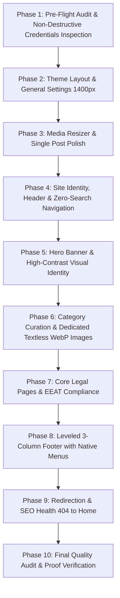

# 🚀 Universal Site Setup Master Skill (v2.0)

[](https://github.com/tntayyab/site-setup-skill)
[](https://wordpress.org/)
[](#)
[](LICENSE)

An enterprise-grade autonomous website setup protocol designed for **Google Antigravity**, **Claude**, **ChatGPT**, **Cursor**, and **GitHub Copilot**. Transforms fresh WordPress and Themixify installations into pristine, high-converting, fully compliant editorial brands with zero manual intervention.

---

## ⚡ How to Invoke in Any AI Assistant

Simply paste the following one-line prompt into any AI agent session:

```text
Please read and execute the autonomous site setup protocol from:
https://raw.githubusercontent.com/tntayyab/site-setup-skill/main/SKILL.md
Target Website URL: [INSERT YOUR WEBSITE URL HERE]
```

The AI will ingest the skill, enforce all 10 setup phases, and execute the complete deployment autonomously.

---

## ⛔ Strict Zero-Tolerance Rules

Every setup governed by this skill strictly enforces the following non-negotiable standards:

1. **Zero Dual Search Bars:** Never display two adjacent search bars.
2. **Leveled 3-Column Footer:** Native WordPress Navigation Menus only (`nav_menu`), perfectly leveled across About, Categories, and Legal pages.
3. **100% Textless Category & Hero Images:** Dedicated, photographic WebP images (`800x533 px`, `< 100 KB`) with zero printed titles or banner overlays.
4. **Mandatory Themixify Settings:**
   - Site Width: `1400px`
   - Top Sliding Trending Bar: `ON` (marquee auto-scroll)
   - Bottom Posts Bar: `OFF`
   - Single Post Featured Image: `OFF`
   - Share Row Under Title: `OFF`
   - Media Resizer: All 4 toggles `ON` (`600x400 px` images, `600x338 px` videos)
   - 404 Redirect: Send all 404s to homepage (`301 Permanent`)
5. **Unique EEAT Author Personas:** 100% distinct face and niche-specific persona per site (strictly WebP, `< 40 KB`).
6. **Audit-First (Non-Destructive) Integration:** Never overwrite existing healthy GA4, Search Console, or Bing tracking IDs.

---

## 🛠️ The 10-Phase Autonomous Workflow



| Phase | Description | Key Deliverables |
| :--- | :--- | :--- |
| **Phase 1** | Pre-Flight Audit | Health check, credentials inspection, trash default sample page |
| **Phase 2** | Theme Layout | 1400px container width, top sliding trending bar ON, bottom bar OFF |
| **Phase 3** | Media Resizer & Polish | Image & video resizer ON, share row under title OFF |
| **Phase 4** | Header & Navigation | High-res logo, 512x512 favicon, Primary Menu, zero search redundancy |
| **Phase 5** | Hero Visuals | 2-3 cinematic textless 16:9 slides, high-contrast CTA buttons |
| **Phase 6** | Category Curation | All posts categorized, dedicated textless WebP images on all cards |
| **Phase 7** | Legal & EEAT | 6 mandatory compliance pages, no dummy links, unique author avatar |
| **Phase 8** | Leveled Footer | 3-column symmetry, native WordPress navigation widgets, FTC disclosure |
| **Phase 9** | SEO & Redirects | 301 redirect all 404s to homepage, sitemap submission, analytics |
| **Phase 10** | QA & Verification | Cache purge, visual audit across devices, high-res proof screenshots |

---

## 📁 Repository Structure

```text
site-setup-skill/
├── SKILL.md                 # Core master instruction manual for AI agents
├── README.md                # Public documentation and quick-start guide
├── checklist.md             # Complete step-by-step audit & QA checklist
└── references/
    └── sop-rules.md         # Detailed field specifications and parameter reference
```

---

## 🔄 Self-Evolution Protocol

This repository is permanently self-evolving. Whenever new rules, theme parameters, or operational instructions are introduced during live site setups, the executing AI agent commits and pushes the updated directives directly to `main`, ensuring universal continuous improvement.

---

## 📄 License

Distributed under the MIT License. See `LICENSE` for more information.
